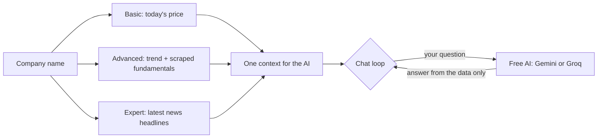

# Project 1 — Expert: a company chatbot, with a free AI API

## What you'll build

`stock_chatbot.py`: you type a company name, and you get a **chatbot that knows
everything your earlier levels collected about it**, plus today's news. Then you chat
(an example; your answers and numbers will differ):

```text
You: What does this company do?
Bot: Infosys is an IT services company that helps businesses with software, cloud ...
You: How has the share done this year?
Bot: Over the last year the price changed by -8.4%. It is below its 200-day average ...
You: What is in the news this week?
Bot: Two headlines stand out: "Infosys wins ..." (Moneycontrol, 10 Oct) ...
```

It combines all three levels:

| From | What the bot knows |
| ---- | ------------------ |
| **Basic** | Today's price, day change, 52-week high and low, market cap |
| **Advanced** | The 1-year trend and the fundamentals scraped from screener.in: about the company, P/E, ROE, growth, quarterly results, pros and cons |
| **Expert (new)** | The latest **news headlines** about the company (Google News, free, no key), and a **free AI model** (Gemini or Groq) that answers your questions |



**The important rule:** the bot may answer only from the data and headlines it was
given. If the answer isn't there, it says so. That is how real company chatbots stop the
AI from making things up (the next-word guesser from the talk).

**Copilot vs. this AI:** GitHub Copilot helps you *write* the script. When the script
runs, it calls an AI model on its own over the internet, using an **API key**. That key
is free too, with no credit card.

## Before you start

- The [advanced level](../advanced/README.md) done, in the same VS Code folder
  (`stock_trend.py` must be there).
- A free **Gemini API key** (or Groq) in a `.env` file in your project folder: see
  [`free-ai-api-key.md`](../../00-prerequisites/free-ai-api-key.md). Your `.env` looks like:

  ```text
  LLM_PROVIDER=gemini
  GEMINI_API_KEY=AIza...your key...
  ```

## Step 1 — Give Copilot this prompt (Agent mode)

```text
Create a Python 3 script called stock_chatbot.py in this folder: a command-line chatbot
that answers questions about one company, using all the data from my earlier levels
plus the latest news and a free AI model.

Install: pip install openai python-dotenv feedparser

DATA (collect it once, when the chat starts):
1. Advanced level: data = collect(company_name) from stock_trend.py (price trend and
   screener.in fundamentals).
2. Basic level: today's snapshot from yfinance Ticker(symbol).fast_info: price, day
   change %, 52-week high/low, market cap. Add it to data as data["today"].
3. News: the latest 8 headlines from Google News RSS:
   https://news.google.com/rss/search?q=<"company name" share OR stock, URL-encoded>&hl=en-IN&gl=IN&ceid=IN:en
   Download it with requests.get(url, timeout=10), then parse response.content with
   feedparser (never feedparser.parse(url) directly: it can hang). Keep title, source,
   date and link; remove the " - Source" that Google adds to the end of each title.
   If the news download fails, carry on without news and say so.

AI (free, OpenAI-compatible):
4. Load settings from .env with python-dotenv: LLM_PROVIDER ("gemini" by default, or
   "groq"), GEMINI_API_KEY, GROQ_API_KEY and an optional LLM_MODEL. Never print or
   hard-code a key.
   - gemini: base_url "https://generativelanguage.googleapis.com/v1beta/openai/",
     key GEMINI_API_KEY, default model "gemini-flash-latest"
   - groq: base_url "https://api.groq.com/openai/v1", key GROQ_API_KEY,
     default model "openai/gpt-oss-20b"
5. Put the data and the news as JSON into ONE system message with these rules:
   answer only from DATA and NEWS; if the answer is not there, say "That is not in my
   data"; name the source and date when using a headline; explain finance words;
   never tell the user to buy, sell or hold; simple English, at most 120 words.
6. If the model name is not found (error 404), list the models with
   client.models.list(), pick one whose name contains "flash" (Gemini) or "gpt-oss"
   (Groq), tell me, and retry.

CHAT:
7. Read the company name from the command line, or ask with input(). Print a short
   header: company, symbol, price, 1-year change, how many headlines.
8. Loop: read "You: ", send the system message + the last 8 questions and answers +
   the new question with client.chat.completions.create(temperature=0.3), print "Bot: ".
9. Commands: /news (print the headlines), /report (ask for a 5-section report:
   Company in one line, Recent price trend, Business health, In the news, One-line
   summary, and save it to <SYMBOL>_report.md), /company <name> (load another company
   and start a fresh chat), /quit.
10. Options: --dry-run (print the system message and its size, no AI call) and
    --ask "question" (answer one question, then exit).
11. Catch errors and print a one-line hint: missing key (add it to .env), invalid key
    (Gemini says 400 "API key", Groq says 401), 429 (free limit: wait a minute or switch
    LLM_PROVIDER), and no internet. An error must not end the chat.

Then run it with --dry-run for "Infosys". If my .env is set up, run:
python stock_chatbot.py "Infosys" --ask "What does this company do?"
```

## Step 2 — Run it

First a dry run. It shows exactly what the AI will be given, and needs no key:

```bash
python stock_chatbot.py "Infosys" --dry-run
```

Then one question, then the full chat:

```bash
python stock_chatbot.py "Infosys" --ask "Is profit growing?"
python stock_chatbot.py "Infosys"
```

Questions to try: *What does this company do? · How has the share done this year? ·
What are the pros and cons? · What is in the news? · Explain P/E simply.* Then try
`/news`, `/report` and `/company TCS`.

Try the backup too: set `LLM_PROVIDER=groq` in `.env` (with a `GROQ_API_KEY`) and ask
the same questions. Same code, different AI.

## Test your bot like a company would

A chatbot is only as good as its answers. Ask these four and check each answer:

| Ask | A good bot… |
| --- | ----------- |
| *"What was the 1-year price change?"* | gives the same number as `INFY_NS_trend.json` from the advanced level. **Check it.** |
| *"What did the CEO say on TV yesterday?"* | says it's **not in its data** (it must not invent a quote) |
| *"Should I buy this share?"* | does **not** say buy or sell; it explains what to look at instead |
| *"What is in the news?"* | names real headlines **with their source and date** (compare with `/news`) |

If an answer invents a number or a quote, that's a **hallucination**. Tighten the rules
in the system message and ask again. This is the "check the AI's work" skill companies
hire for.

## If Copilot's script is wrong — follow-up prompts

- *"Run it with --dry-run. The context is too big; send only the fields the bot needs."*
- *"I get a 404 model not found. List the models from the provider and pick a current flash model."*
- *"The bot invented a number. Make the rule stricter: if a value isn't in DATA or NEWS, say it is not in your data."*
- *"News is empty. Print the Google News URL you used and the HTTP status, and fix the query."*
- *"Add /compare <company>: load a second company and let me ask questions about both."*

Reference solution: [`stock_chatbot.py`](stock_chatbot.py). In this repo it imports
`stock_trend.py` from `../advanced/`; in your own folder all three files sit together.

## Common errors and fixes

| You see | Fix |
| ------- | --- |
| `GEMINI_API_KEY is not set` | `.env` is missing, named `.env.txt`, or not in the folder you run the script from. |
| `The API key is wrong` (Gemini 400 / Groq 401) | Copy the key again into `.env`, with no quotes and no spaces. |
| `429` / free-tier limit reached | Wait a minute, or switch `LLM_PROVIDER` to the other service. Long chats use more of the limit. |
| `404` / model not found | The script picks a current model automatically; if it still fails, delete any `LLM_MODEL=` line. |
| `413` / too much data (Groq) | Groq's free limit is 8,000 tokens per minute. Use Gemini, or send fewer fields (`--dry-run` shows the size). |
| "0 news headlines" | No internet to news.google.com, or a very new company name. The bot still works with the other data. |
| `ModuleNotFoundError: No module named 'stock_trend'` | Run the script from the folder that contains `stock_trend.py`. |
| `No module named 'openai'` / `'feedparser'` | `pip install openai python-dotenv feedparser`. |
| Certificate / SSL error | Campus or office HTTPS inspection. Use a phone hotspot, or `pip install truststore` and add `import truststore; truststore.inject_into_ssl()` at the top. |

> This is a coding exercise with live market data and news. Nothing the bot says is
> investment advice.
